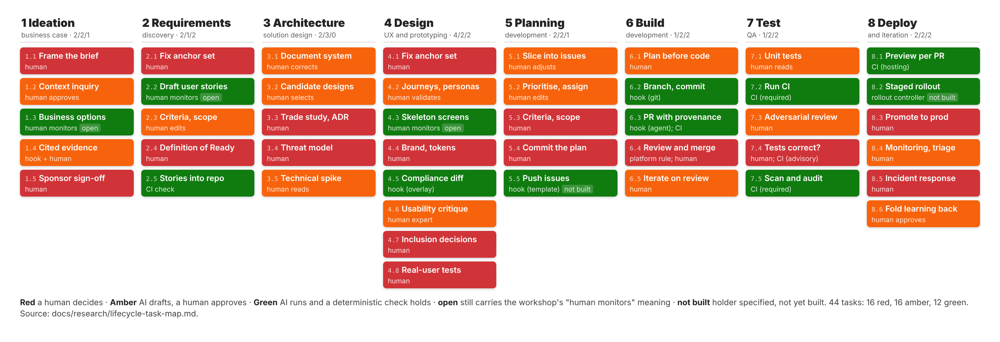
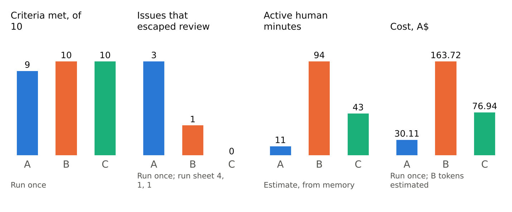
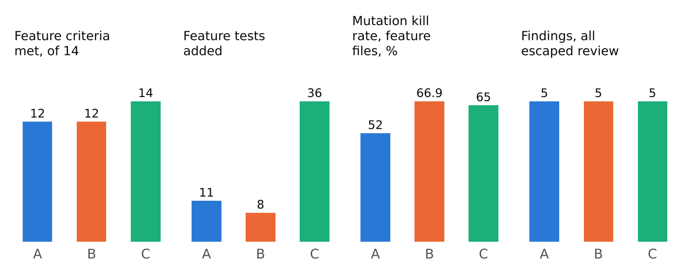
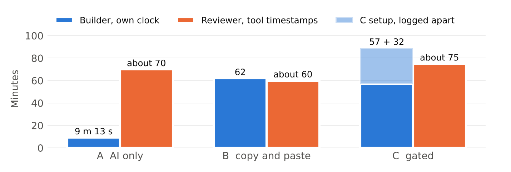
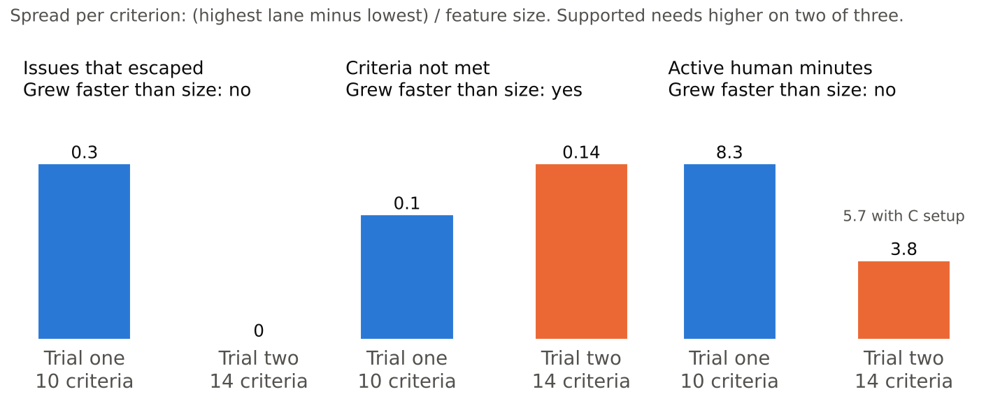

<!-- toc -->
## Contents

- Abstract
- 1. Introduction
    - 1.1 Context
    - 1.2 Problem
    - 1.3 Research questions and hypothesis
    - 1.4 Contributions
- 2. Background
    - 2.1 The client baseline
    - 2.2 Industry engineering practice
    - 2.3 Empirical evidence on AI-assisted development
    - 2.4 Regulation that applies to NBN Co
- 3. Method
    - 3.1 Overview
    - 3.2 Desk research and citation audit
    - 3.3 Workshop analysis and interviews
    - 3.4 Constructing the map
    - 3.5 The instrumented repository
    - 3.6 Proof of concept
    - 3.7 Trial one
    - 3.8 Trial two
    - 3.9 Measures and provenance labels
- 4. Results
    - 4.1 The map (RQ1)
    - 4.2 Holders, and the state of the repository (RQ2)
    - 4.3 Interviews, traced to gates
    - 4.4 Proof of concept
    - 4.5 Trial one
    - 4.6 Trial two (RQ3)
    - 4.7 The hypothesis
- 5. Discussion
    - 5.1 What the count missed
    - 5.2 Which holders did the work
    - 5.3 Instruction files are not gates
    - 5.4 Against the literature
    - 5.5 What the gates buy
    - 5.6 Threats to validity
- 6. Limitations
- 7. Conclusion
- Appendix A. Terms
- Appendix B. Stages 5 to 8, task by task
- Appendix C. The eighteen attacks
- Appendix D. Evidence index
- Appendix E. The registered prediction, as committed
<!-- /toc -->

# Abstract

NBN Co asked for a software development lifecycle that uses AI, across its eight stages, with a traffic-light view of where AI may act. The client's own workshop in June 2026 produced a colour per stage. A colour per stage cannot be acted on, and one study finds LLM-generated test assertions correct 39 to 59 percent of the time across two datasets, which makes "the tests are green" an unsafe gate. We opened the eight stages into 44 tasks, gave each a colour that says who decides, a gate that says what must be true before the next task starts, and a holder that says what makes the gate hold. Six holders exist; an instruction file is not one of them. We tied every stage to Google, Microsoft, GitHub and DORA practice (63 claims in the research spine audited against their sources), compared the map with two developer interviews, one of them with the project supervisor and the workshop record, and built the gates into a live repository. We then ran a pre-registered trial: one frozen brief, one base commit, three build methods (AI only, copy and paste, and the gated lifecycle run as an instruction file with the builder approving each stage), a reviewer from the team who wrote the map and the protocol and built none of them, 17 criteria, 18 attacks, a mutation run and two seeded faults per build. The registered hypothesis, that the methods would spread further apart on the larger feature than the feature grew, was not supported on the registered counts. What differed was kind: two builds met twelve of fourteen feature criteria, passed every automated check, and stored nothing; the gated build met fourteen, held all eighteen attacks at the database rules, at the server and signed out, and had the test that caught the ownership fault. No gate in any lane caught the missing data store before merge, and both builders recorded the two criteria as met. The plan step in lane C is where its builder chose a store; no lane ran a review by a second person. We report the method, the numbers with their provenance labels, the threats to validity, and what a team installs and decides to run the gated lifecycle.

# 1. Introduction

## 1.1 Context

NBN Co's brief of 15 August 2026 asked the team for four things: an operational manual that takes a feature request to production using AI, a demonstration run through that lifecycle, a governance and token model, and a learning path for junior developers. The brief rests on a workshop NBN ran in June 2026 with RMIT: four days, two cohorts of around 32 to 35 people, each cohort given a demonstration day and a build day on a customer fault-reporting exercise. The demonstration walked eight lifecycle stages and classified each as red (human decision), yellow (AI drafts, human approves) or green (AI executes, human monitors). The team reviewed the four recordings, 11 hours 19 minutes, in Sprint 1 deliverable D2 [1].

Two facts from that review shaped everything after. The classification was given per stage, and the facilitator said the boundaries move: "as you build the environment and the environment learns from you, you can slowly perhaps move some of those yellow tasks into the green area, because something that was assisted before, now you improve the governance, you also improve the process itself" [1]. He tied that to the repository's rules file. And the workshop never reached deployment, never raised accountability for machine-written code, and left one question on the table at stage 7: "the question would be, are all the tests correct?" [1].

## 1.2 Problem

A colour per stage states a policy without a procedure. The workshop marked stage 6 yellow but did not say what a developer does when they pick up a stage 6 task, or what stops them skipping the approval. The brief asked for a manual, a set of procedures, and the original workshop gave none.

The second part of the problem is in the literature. Large models choose the insecure option in 45 percent of security-relevant tasks [2]. About 40 percent of Copilot-generated programs in one study were vulnerable [3]. Across 304,362 AI-authored commits, 24.2 percent of the issues AI introduced were still present at repository head, and security issues were the most likely to survive [4]. Generated test assertions were correct between 39 and 59 percent of the time across two datasets [5]. An agent that writes the code and the tests passes its own tests. That is the workshop's stage 7 question, whether the tests are correct, and giving the stage a colour does not answer it.

The third part is practical. Most AI governance in a repository is text an agent is asked to read: an instructions file, a prompt, a skill. Whether the agent complies is up to the agent. A manual that says "the agent must stop for approval" and relies on an instructions file to make it so is wishful thinking.

## 1.3 Research questions and hypothesis

RQ1. Does published engineering practice support the client's eight-stage colour scheme when it is applied task by task, and where does it not?

RQ2. What mechanisms can hold a gate in a GitHub repository, and which of them hold against an AI agent as well as against a person?

RQ3. On the same feature, from the same brief and the same base, does building with the gated lifecycle change what ships compared with an AI-only build and a copy-and-paste build?

H1, registered 12 October 2026 before the trial two protocol was written and before any build began [6]: on the bigger feature, the three builds will end up further apart than they did in trial one, by more than the feature grew. Spread on a measure is the highest build's result minus the lowest, divided by feature size (10 criteria in trial one, 14 in trial two). Three measures decide: issues that escaped review, feature criteria not met, active human minutes. Supported if trial two's spread per criterion is higher on at least two of the three.

## 1.4 Contributions

A task-level map of the eight stages, 44 tasks, each with a colour, a gate and a holder, every stage tied to published practice and audited (section 4.1). A holder taxonomy of six, which excludes instruction files by definition because compliance with them is the agent's choice; the dry run shows an agent choosing to comply (4.2). The gates built into a repository as git hooks, an agent hook, six CI checks and a ruleset (3.5). A pre-registered three-method trial with an independent review protocol and a full evidence record (3.8, 4.6). A registered test that did not separate the methods, reported as registered, and what the builds differed in instead (4.7, 5.1).

# 2. Background

## 2.1 The client baseline

The June workshop's classifications were: stage 1 red with a yellow first draft; stage 2 green for first-draft user stories, the only green; stage 3 red as delivered, yellow if context improves; stage 4 green for journey mapping, red for brand and design; stages 5, 6 and 7 yellow; stage 8 not reached [1]. Three practices were taught alongside: write the issue properly with acceptance criteria; always state what is out of scope ("I wanted to make a small change and it ended up changing 35 different files"); separate the instructing role from the building role [1]. The team's lifecycle keeps the eight stages and these three practices and changes what a colour means and where it sits.

## 2.2 Industry engineering practice

Four source bodies were read as the published state of practice, ranked above peer-reviewed research for verdicts on what organisations do and below it for verdicts on what AI can do [7].

Google. Every change requires a human review approval: "a correctness and comprehension check from another engineer that the code is appropriate and does what the author claims it does" is one of three required approvals [8]. The review standard puts design first and asks whether the code has appropriate, well-designed tests [9]. Small changes are a stated discipline: "write CLs smaller than you think you need" [9]. Releases are gated behind role-based human approvals. The Design Sprint supplied the scaffold for stages 1 to 4 [10].

Microsoft. The Security Development Lifecycle requires clearly defined security and privacy requirements set by the development team, and review by someone other than the author [11]. The Code With Engineering Playbook supplies the planning artefacts the map leans on: Definition of Ready, Minimal Slices, Work Items, design reviews "front-loaded before implementation", ADR and trade-study templates, dev-sec-ops secret and dependency scanning, and the observability pillars [12].

GitHub. The Copilot coding agent takes an assigned issue, researches the repository, plans, works on a branch, runs tests and opens a pull request; a human must approve workflow runs; an `@copilot` mention requests changes [13]. The agent flow in stage 6 is this flow with gates named.

DORA. The 2024 report measured a 1.5 percent drop in throughput and a 7.2 percent drop in stability per 25 percent increase in AI adoption [14]. The 2025 report reversed the throughput finding but kept the finding that "AI adoption does continue to have a negative relationship with software delivery stability", found about 30 percent of respondents had little or no trust in AI-generated code, and framed AI as an amplifier: "AI doesn't fix a team; it amplifies what's already there" [15]. Its capabilities, working in small batches, continuous integration with checks required before merge, deployment automation, give stages 5, 7 and 8 their deterministic gates [16].

## 2.3 Empirical evidence on AI-assisted development

Productivity evidence is contested. A randomised trial on a bounded HTTP task found developers 55.8 percent faster with Copilot (95 percent CI 21 to 89, n = 95 freelancers) [17]. Field experiments across three firms (n = 4,867) found 26.08 percent more completed pull requests [18]. A randomised trial with sixteen experienced developers on mature repositories found them 19 percent slower with AI while believing they were 20 percent faster [19]. GitHub's own randomised trial reports small authoring-quality gains and reviewers 5 percent more likely to approve [20].

Quality and security evidence points one way. Veracode's 80-task study found the insecure option chosen 45 percent of the time, with Java at 72 percent and cross-site scripting at 86 percent [2]. Apiiro reported vulnerabilities rated CVSS 7.0 or higher about 2.5 times more frequent in AI code [21]. Pearce et al. found about 40 percent of Copilot programs vulnerable [3]. Liu et al., the largest sample, found a quarter of AI-introduced issues surviving to head and security issues surviving most [4]. Copilot's own review produced "fewer than 20 comments, most of which addressed spelling or minor style issues" across seven vulnerability datasets, missing SQL injection and cross-site scripting [22].

Test generation evidence is the one the workshop's open question needs. LLM-generated assertions were correct 51.82 to 58.71 percent of the time on one dataset and 38.72 to 48.19 percent on another [5]; coverage can be high while correctness is not [23]. Requirements and UX evidence (user stories less diverse and meeting acceptance criteria less often than human ones; synthetic personas "susceptible to caricature"; accessibility critique covering 69 percent of expert-found errors at 71 percent precision) supported amber rather than green for stages 2 and 4 [24], [25], [26], [27].

Methodological flags carried into the design: the strongest pro-AI trial used an artificial task and freelancers; the strongest anti-AI trial had n = 16 and calls itself a snapshot; the code-review study is a preprint on a preview build; Veracode sells security tooling [7].

## 2.4 Regulation that applies to NBN Co

NBN Co operates critical infrastructure under the Security of Critical Infrastructure Act, which can make a production promotion a regulated act; the Privacy Act and the facilitator's instruction at the workshop not to put NBN material into the personal AI accounts in use meant the trials ran on invented data [28]. These set two red tasks (8.3, 8.5) and the fixture design in 3.8.

# 3. Method

## 3.1 Overview

The work ran in three sprints between 15 August and 20 October 2026. Sprint 1 produced the research (D2 workshop review, three research slices, two source notes, a citation audit, two interviews) and the map (D4). Sprint 2 produced the operational modules for stages 5 to 8, the instrumented repository, a proof of concept, and trial one for the client showcase. Sprint 3 produced the pre-registered trial two, its independent review, and the white paper this paper condenses. Every artefact is in the public repository `Peepachuu/nbn-sdlc-demo` with its commit history; where a figure was estimated rather than measured, it carries the label Estimate (section 3.9).

## 3.2 Desk research and citation audit

Two team members wrote source notes on Google's and Microsoft's published practice. The spine document (slice 1) then tested each of the eight stages' baseline colours against both bodies and the empirical literature, recording a verdict per stage (confirm, challenge, source silent) and a reconciliation line where the two authors disagreed [7]. Before circulation, every citation in the spine was audited: 63 falsifiable claims were extracted, each identifier fetched live, each quoted figure checked against its source. The result was 48 verified, 14 partially verified, 1 misattributed, 0 fabricated identifiers; 15 edits were required and applied in the spine, four substantive (one re-attribution, two corrected figures, one quote cut) and eleven minor (dates, de-quoting stitched sentences) [29]. Section 2 above uses the corrected values. Slices 2 and 3 went to operational depth on stages 5 to 8 (commits, branches, harnesses, review) and on the governance that surrounds every stage [30], [28].

## 3.3 Workshop analysis and interviews

The four workshop recordings were transcribed, the silences verified by listening, and the findings tested across both cohorts; findings that replicated across rooms were separated from single anecdotes [1]. Two semi-structured interviews with experienced developers were run on 12 and 17 September 2026, the first with the project supervisor in a cautious adoption setting and the second with a developer in an organisation where AI performs most implementation; each finding was coded as confirming, adding to or contradicting the research [31]. No junior developer and no NBN developer was interviewed (section 6).

## 3.4 Constructing the map

The supervisor's review on 31 August set the structural rule: colours belong to tasks, not stages, because one stage can hold green copywriting and red brand decisions at once [7]. Each stage was opened into tasks, 44 in all, from the workshop walkthrough, the source bodies and the slices. Each task carries three attributes. Colour says who decides: red, a human decides; amber, AI drafts and a human approves; green, AI runs and a deterministic check holds. The gate is a countable condition that must be true before the next task starts. The holder is what makes the gate hold, one of six holders fixed in the module reconciliation, or the label that says there is none: hook (git), hook (agent), CI check (required), CI check (advisory), platform rule, human, no gate [32]. The seventh label, no gate, is for instruction files, prompt files, skills and an agent's own summary: whether an agent complies with them is up to the agent, so by definition they hold nothing.

Scope was narrowed by an architecture decision record: stages 6 and 7 in full depth, 5 and 8 to their handoffs, stages 1 to 4 assumed handled and represented by an entry gate of four artefacts (an approved business case; stories with checkable criteria; recorded architecture decisions with a human approver; agreed journeys and design) [33]. The record gives the reasoning: the evidence concentrates where AI writes and ships code; five people and two sprints cannot specify eight stages at operational depth; the team has a live pipeline, so stage 8 can be shown rather than inferred.

## 3.5 The instrumented repository

The demonstration codebase is a Next.js and Firebase boilerplate used by RMIT's industry programme. By the trial two base commit `6af6a5b` the team had added five mechanisms. Lefthook git hooks run a secret scan, the placeholder check, prettier and eslint before each commit, and enforce Conventional Commits, a 100-character subject and a lower-case scope on each message. A Copilot agent hook (`scripts/copilot/pre-tool-use.cjs`) denies the agent `git push`, `--no-verify` and any change to the hooks, and returns the reason. Six GitHub Actions checks (AI Declaration, AI Attribution, Lint & Typecheck, Frontend Tests, Backend Unit Tests, Security Scan) run alongside an advisory mutation job. A pull request template carries an AI declaration. A ruleset on `main` requires two approving reviews with the author excluded, squash merge only, no force push, no deletion, and the six checks. The AI Attribution check fails a pull request that declares AI use without a `Co-authored-by` trailer naming the agent on at least one commit. Two of the team's own Sprint 1 findings drove this: no commit in the team's early history carried AI attribution, and a branch rule requiring two approvals targeted no branches, so pull requests had merged with none [33].

## 3.6 Proof of concept

A fault-reporting feature (FR-01, six acceptance criteria) was built through stages 5 to 7 with Copilot CLI by one builder, 27 September to 2 October 2026; no deployment or production promotion was performed, and the second team member's review requested for it is recorded as pending. Mutation testing with Stryker was run on the frontend after implementation (63.64 percent) and after a focused test revision (73.86 percent). Two seeded faults were applied and the suite rerun: a blank description accepted, and a direct-id ownership bypass. A separate read-only agent review was also run. Time and usage were written up afterwards from the builder's recollection and are labelled estimates [34].

## 3.7 Trial one

For the client showcase on 1 October 2026 the same cut-down fault report (ten criteria) was built three ways by three builders: A, AI only (Codex); B, copy and paste between ChatGPT and the editor; C, the team's gated method (Codex). Builds ran 25 to 26 September on separate repositories from the shared base with its known gaps still open. Times and usage were written down from memory two days later. A teammate reviewed the builds without a fixed attack list. Trial one is reported as context and as the baseline the registered prediction uses; its figures carry the label Estimate throughout [35].

## 3.8 Trial two

Trial two was designed to remove the weaknesses of trial one in a fixed order that git records.

Feature and criteria. Technician dispatch: a requester records a fault and an access requirement at a premises, the application offers only technicians whose skills and equipment satisfy both, and a visit is scheduled. Fourteen feature criteria (T2-AC01 to AC14), three record criteria (AC15 to AC17) and an out-of-scope list were frozen in commit `f43ca98` on 10 October [36]. Second-storey and pit-access cases were written into the criteria so that an incompatible match is a testable failure.

Prediction. H1 and its measurement rules were committed on 12 October (`48fff18`), with expected directions stated as directions and the limits stated before the run [6].

Base and lanes. All three lanes started from one commit, `6af6a5b`, tagged `trial2-base`: `main` with trial one's feature and its runbook removed and the hook, CI and ruleset gaps closed. Each lane had its own repository, and builders were assigned as in trial one. Lane A moved to a fresh repository and lane C to a fork before building, and neither carries the template's ruleset, so the two-approval rule and the six required checks gated lane B's pull request only [37]. Every lane was instructed to use GPT-5.6 Sol at high effort (Codex for A and C, ChatGPT for B); section 4.6 reports what each record names. Each build had a four-hour estimate and a six-hour cap, with setup time logged apart. A shared fixture of four technicians, three faults and three access requirements was supplied to all lanes as `fixtures/technicians.json`; the test jobs and attacks were withheld from builders until their build was frozen. In lane C the gated lifecycle took the form of a 178-line `AGENTS.md` in the repository root, which the builder adapted from his trial one file. It sets five stages (plan with no edits, tests first, implement and verify, review and correct, preview and acceptance) and stops for the builder's approval after each. The builder sent the brief as prompt 1 and after that the run sheet's approval replies, such as "Plan approved. Go to stage 2 and write the tests first.", plus one request for a dependency fix; the messages themselves are recorded only as a link to the chat. The git hooks and CI checks were the same in every lane. The Copilot agent hook ran in none, because no lane built with Copilot: lanes A and C used Codex, and lane B removed the Copilot files before starting.

Protocol. The protocol was committed on 17 October, before the first clock-on. It set one test job per criterion, each with a pass condition and an evidence file name, and eighteen attacks run on every build in the same order (Appendix C). Each build also got a mutation run, with the formula stated and no threshold, and two seeded faults applied by hand: S1 removes the owner check before scheduling, and S2 makes the access-equipment check always pass. Findings fall into nine categories and three severities. Builds were reviewed in the order their pull requests opened, and nothing from one build was read into the next [37]. On 18 October, before any build was opened for review, each attack was marked as to whether trial one had also run it, so that the escaped-issue count compared with the prediction uses only checks trial one ran.

Builds and freeze. Builds ran 17 to 18 October. The project manager declared the builds frozen at 22:27 on 18 October; the reviewer read the pull-request heads at 22:58 (`f1611e0`, `ed173dc`, `40c65f5`) and reviewed those and nothing later.

Review. The reviewer is a team member who authored the map and the protocol and built none of the three. Offline checks (clean clone, typecheck, lint, tests, dependency diff, secrets, declaration, record) ran the night of the freeze; preview checks, attacks, mutation and seeds ran on 20 October. Every result is a file under `docs/research/trial-two/review/` [38].

## 3.9 Measures and provenance labels

Every figure in the record carries one of four labels: Run (reproducible from a committed artefact), Run once (observed once and recorded, with the evidence file), Estimate (a person's recollection, named), Documented (stated in a source and not exercised). The paper keeps the labels. Mutation score is killed mutants divided by valid mutants; both the configured scope and the feature-files-only figure are reported because 73 mutants in the configured scope sit in base files no build touched.

# 4. Results

## 4.1 The map (RQ1)

The eight stages open into 44 tasks: 16 red, 16 amber, 12 green. By stage: 1 (5 tasks: 2 red, 2 amber, 1 green), 2 (5: 2, 1, 2), 3 (5: 2, 3, 0), 4 (8: 4, 2, 2), 5 (5: 2, 2, 1), 6 (5: 1, 2, 2), 7 (5: 1, 2, 2), 8 (6: 2, 2, 2) [39]. Compared with the June workshop's colours, stage 2, the only green stage, became mixed on the requirements-engineering evidence: drafting stories stays green with a person monitoring, the criteria are amber, and the anchor set and acceptance are red. Stage 4's journey mapping became amber. Stages 5 to 7 were confirmed amber overall and split into tasks of all three colours. Stage 8, unreached at the workshop, was classified from DORA and progressive-delivery practice as green for preview and rollout mechanics, amber for monitoring and context updates, red for production promotion and incidents [7]. The stage order held as a taxonomy of concerns and not as a sequence: both source bodies describe trunk-based collapse of plan, build and test [16]. Two verdicts were "source silent" (ideation; brand decisions) and are recorded as such.

## 4.2 Holders, and the state of the repository (RQ2)

Of the 21 tasks in stages 5 to 8, seven are green and each names a deterministic holder: 5.5 an issue template (specified and not built); 6.2 the git hooks; 6.3 the agent hook and the AI Declaration and Attribution checks; 7.2 and 7.5 required CI checks; 8.1 the hosting platform's preview check; 8.2 a rollout controller that is specified and not built. Six are red and held by a person: 5.3, 5.4, 6.4 (with the ruleset), 7.4, 8.3, 8.5. Eight are amber and held by a human approval. In stages 1 to 4, three green tasks (1.3, 2.2, 4.3) name no deterministic holder and keep the workshop's meaning of green, AI runs and a person monitors; by the rule above they read as amber, and the relabel is recorded as open. With 5.5 and 8.2 specified and not built, five of the twelve green tasks have no holder that exists today.

Three things about holders were established by running them rather than reading about them. First, a git hook runs for every tool and every person who installed the repository, and a human can skip it with `--no-verify`; the agent hook closes that gap for the agent and returns the reason. Second, an agent hook applies only to the tool it is installed in and fails open after its timeout; nothing constrains a chat window in a browser. Third, instruction files are not gates. In a dry run of the plan-approval gate, the agent "stopped and waited for approval" as the instructions asked, and the record states the gate "was demonstrated through agent behaviour, not through a deterministic enforcement mechanism" [40]. On `main` the repository's own `CLAUDE.md` still titles its instruction text "Mandatory AI Development Gates"; by the taxonomy it holds nothing, and the fix is recorded as open. One more fact about the base. The trial two template carried a ruleset requiring all six checks and two approvals, and only lane B built in a repository that kept it (section 3.8). On the team's shared repository the ruleset requires only the AI Declaration check. So the six-check gate was proved on one trial repository; in lanes A and C the six checks ran on the pull request without being required to pass.

## 4.3 Interviews, traced to gates

Both interviews supported scoped autonomy, human validation of critical outputs and human responsibility for the result, and differed on provenance: one team does not identify AI-written code in the repository; the other records the model used per story [31]. Each finding maps to a task. "Passing AI-generated tests does not prove the requirement" is task 7.4 with mutation and seeds as evidence. "The team does not identify AI-generated code" is task 6.3's trailer and the declaration checks. "Small, well-scoped tasks; unrestricted access avoided" is 5.3's out-of-scope list and the agent hook. "Large features start with a plan" is 6.1. "Data design is checked before accepting" is 7.4. Sections 4.6 and 5.1 report what trial two showed on each.

## 4.4 Proof of concept

FR-01 met its six criteria, with automated evidence for each, and 5 backend and 24 frontend tests passed at the end. The frontend mutation score was 63.64 percent after implementation and 73.86 percent after a focused test revision, and both seeded faults were caught after the revision. The independent agent review found no significant defect, though it was not a blind seeded-defect search. Time (about 240 minutes generating including prompting; about 35 minutes of the builder's own review) and usage (69.05 AI Credits across four daily account totals) are estimates and partial figures respectively [34].

## 4.5 Trial one

| Measure | A, AI only | B, copy and paste | C, gated | Label |
| --- | --- | --- | --- | --- |
| Feature criteria met, of 10 | 9 | 10 | 10 | Run once |
| Issues that escaped review | 3 | 1 | 0 | Run once, under reconciliation against the run sheet, which reads 4, 1, 1 |
| Active human minutes | 11 | 94 | 43 | Estimate, written from memory two days later |
| Total cost at A$100 an hour plus list-price tokens | A$30.11 | A$163.72 | A$76.94 | Run once; B's token figure an estimate |

People's time was 61, 96 and 93 percent of the three builds' cost. The cheapest build per criterion met was the one nobody reviewed, and it let the most issues through [35].

## 4.6 Trial two (RQ3)

Criteria. Lane A met 12 of 14 feature criteria; lane B 12 of 14; lane C 14 of 14. The two failures in A and B are the same two, AC01 and AC11, which the reviewer read as requiring the request and the dispatch record to exist after the page is gone. The frozen text says a requester "can create" a request and that a scheduled dispatch "records" the result, and both builders ticked them as met on screen. On the builders' reading the result is 13, 13 and 14, and H1 then fails on all three measures. Both builds hold the request, the match and the scheduled visit in browser memory. No write leaves the page; a reload returns an empty form. Lane A's dispatch page is also reachable without sign-in. Lane C writes each request through a Server Action that checks the session, and schedules inside a transaction that re-checks owner, status and match [38]. No screen in lane C shows a requester an earlier request; AC01 was passed on the server reading the record back.

Attacks. In lane C all eighteen held. Every direct Firestore read, list, write, update and delete returned permission denied, whether signed in as either requester or signed out. The Server Action refused an incompatible technician, a request with no valid combination, a second schedule, an unknown id, extra fields, and another requester's request without revealing it existed. The signed-out call was redirected before the action ran. In lanes A and B the attacks on the data store had no surface because there is no store; the attacks that applied (double submission, out-of-scope surfaces, keyboard and colour checks) held, and in lane A the unauthenticated-access attack landed.

Tests. Feature tests added: 11, 8, 36. Mutation score over the feature files: 52.0, 66.9 and 65.0 percent (over the configured scope, which includes 73 untouched base mutants: 41.8, 42.5, 53.0). The matching function alone scored 77.4, 100.0 and 79.3 percent; lane C's Server Actions scored 86.4 percent and its fixture loader 0 percent, with no test. Seed S2 (access check always passes) was caught in every lane, by 5, 6 and 7 tests. Seed S1 (owner check removed) applies only to lane C, which caught it with one test, "rejects a cross-owner scheduling attempt without revealing the request". The first two mutation attempts were invalid for configuration reasons and are kept in the record beside the valid run [38].

Findings and gates. Five findings per lane. Lane A: one high (public page), two medium (nothing stored; match enforced in the browser only), two low. Lane B: two medium (the same two), three low (including a cited screenshot missing from its record). Lane C: five low (two record gaps, one test-coverage gap, a tabindex on a card that already holds a radio, and no screen on which a requester can see an earlier request). Caught before merge by any gate, in any lane: none. Findings counted toward the prediction under the decision-5 marking: four per lane, all escaped.

Provenance. Every lane carried a `Co-authored-by` trailer naming the agent and passed the AI Declaration and AI Attribution checks. Three records (lane A's trial record; lane C's pull-request declaration and its commit trailer) name the model as GPT-5, against the lane rule of GPT-5.6 Sol; because each lane had to declare its model, the mismatch is visible in the record, which is what the declaration is for.

Time. Builders' own clocks, elapsed from first prompt to pull request: 9 minutes 13 seconds (A; the run sheet says 14), 62 minutes (B), 57 minutes plus 32 minutes of setup logged apart (C). On the run logs' own definition of active human minutes, active plus reviewing with waiting excluded, the figures are 0, 51 and 36; lane C's 57 splits as 13 active, 23 reviewing and 21 waiting. Reviewer time per build, measured from tool timestamps: about 70, 60 and 75 minutes including the overlapping mutation runs, against a protocol estimate of 210.

## 4.7 The hypothesis

| Measure | Trial one (10 criteria) | Trial two (14 criteria) | Spread grew faster than size |
| --- | --- | --- | --- |
| Issues that escaped, counted on checks both trials ran | 3, 1, 0: spread 0.30 per criterion (4, 1, 1 if reconciled: 0.30) | 4, 4, 4: 0.00 | No |
| Feature criteria not met | 1, 0, 0: 0.10 | 2, 2, 0: 0.14 | Yes |
| Active human minutes | 11, 94, 43: 8.3 | elapsed 9, 62, 57: 3.8 (5.7 with lane C's setup); active 0, 51, 36: 3.6 | No |

One measure of three. H1 is not supported. The reconciliation of trial one's escaped-issue count does not change the result.

# 5. Discussion

## 5.1 What the count missed

The registered measure counts an escaped issue as one unit whether it is a missing screenshot or a feature that forgets everything on reload. On that count the three lanes tied. By kind they did not. Two lanes shipped a feature that met twelve criteria on screen, passed six CI checks, carried a correct AI declaration, and had no persistence layer. One lane persisted every request, refused every forged call, and had written the test that catches the ownership fault before the fault was seeded. The prediction asked whether the gap would widen. The more useful question is where the gap sits, and the trial data show that. It sits at the data design. Lane C's builder chose a server-side store at the plan step (6.1), the one place in the three methods where someone is asked where the data goes; lanes A and B, one of which had a person reading every line, have no such step and stored nothing. Whether a plan approval by someone other than the builder would force that choice was not tested: in this trial the approver was the builder. The test judgement (7.4), reloading the page, is where a reviewer finds the answer afterwards.

## 5.2 Which holders did the work

In lane C the holders that stopped the attacks were, in order of how often they fired: the base's default-deny Firestore rules (every direct access); the Server Action's re-check of owner, status and match inside a transaction (every forged call); the zod strict schema (extra fields); and the session check with redirect (signed out). None of these needed a rule change; the lane never opened a client path to feature data. The one test that caught S1 came from a tests-first step the method requires. No hook refusal or failed check is recorded in any lane, and the agent hook never ran, because no lane built with Copilot. Their value in this trial was that the three records are comparable, every commit is Conventional, every pull request declares its agent, and every check ran on a fresh clone with the same result.

## 5.3 Instruction files are not gates

The base ships instruction files for Copilot and Claude Code that describe a plan-first, approval-gated workflow. Lane A's method removed them before starting, as AI-only requires, and the agent renamed the application and rewrote its home page around the feature (page.tsx, 81 lines changed, and layout.tsx at f1611e0); the protocol does not class that as a scope breach, and AT10 holds. The dry run that preceded the trials recorded that the agent honoured the approval step by choice. The taxonomy's sixth label exists so that no row of the manual can claim enforcement it does not have, and the repository's own `CLAUDE.md` heading is listed as an open correction for the same reason.

## 5.4 Against the literature

The result is consistent with DORA's amplifier thesis: the method with gates amplified a builder who designed for persistence and ownership; the methods without gates amplified speed, and lane A finished in nine minutes [15]. It is consistent with the test-correctness literature: green suites with 52 to 67 percent mutation kill rates and two builds whose suites could not detect the absence of a database, because they never tested for one [5], [23]. It is consistent with the practitioner finding that passing generated tests does not prove the requirement [31]. It does not support the stronger claim that gating reduces defect counts in general; one feature and three builders cannot carry that.

## 5.5 What the gates buy

The client's thesis at the workshop was that a stage moves toward green when automated checks exist or when the agent has more context [1]. The trials split it. Checks held: the hooks and the CI jobs did what they were set to do in every lane, and the ruleset did in the one lane that kept it. The trial did not test context: lane A removed the instruction files, lane C added one and the agent followed it. An instruction file is not counted as a holder because nothing makes the agent follow it, not because the trial showed one being ignored [40]. The holder taxonomy is the form that result takes. A task is green when something deterministic holds it, and nothing that an agent is asked to read counts.

The literature's warning is that review load rises with AI use because output must be reviewed even when it is right (section 2.3). The trial does not show the gated lifecycle reducing review time. Reviewer time was about 70, 60 and 75 minutes across the three lanes, and the gated build took its builder 57 minutes against nine for the AI-only build. What differed is what the review bought. In lanes A and B an hour of review produced a defect list headed by a missing persistence layer. In lane C the same hour confirmed fourteen criteria, eighteen attacks and a caught seed. Review time was about the same in each lane; what it produced was not.

Three further observations bear on cost, and the paper states them as observations. First, lanes A and B are not finished features. Their build times are the cost of a build that fails the brief and would need a second cycle, a second review, and the data design the gated lane's plan step forced up front; trial one showed the same pattern, in which the cheapest build per criterion was the one nobody reviewed and it let the most through [35]. The better unit is time to a correct feature, and the trial did not measure the rework cycle, so no figure is claimed. Second, the gates moved the mechanical part of review to machines: formatting, lint, secrets, commit form, the declaration, the trailer, typecheck, tests and the dependency audit. The human's review in the gated lane reduces to two judgements, the plan and whether the tests would notice. Whether that is less work than reviewing an unguarded build was not measured. Third, the one place review time falls on the evidence is diff size: Google's small-change rule [9]. Lane A, with the out-of-scope list gone, rewrote the home page around the feature; nobody asked for it and a reviewer would have had to read it. Tasks 5.3 and 6.1 are what prevent that. The trial did not measure review minutes per lane finely enough to show the saving, and the paper does not claim it.

Against not using AI the paper has no lane and makes no measured claim. The literature puts the saving in generation [17], [18], with the counterexample on mature codebases [19]. Review is the price of that saving. The gated lifecycle does not remove the price; it stops it being paid for a build that fails the brief. Cost figures with their labels are in the white paper's chapter 7 [35].

## 5.6 Threats to validity

Internal. One builder per method, so builder and method cannot be separated. Lane C's builder authored the gated method he built with. The independent reviewer built none of the three but is a team member and wrote the map and the protocol; the protocol, the decision-5 marking and the frozen commits were committed before the review opened any build, which constrains but does not remove that bias. Builders prepared their own start states with the project manager's agreement (lane B removed the Copilot harness; lane A merged a setup pull request; lane C added the fixture and `AGENTS.md` itself and kept the leftover Copilot instructions); these are recorded as dated amendments to the protocol and applied to the comparison. Lanes A and B opened their pull requests at 00:03 and 01:04 on 18 October; lane C's first prompt was at 13:49 the same day, and its builder asked for access to lane B's preview at 11:37. Lane C's owner check and transaction exist in neither A nor B, so there was nothing to copy, but builder isolation was not enforced.

Construct. An escaped issue counts as one whatever its severity; the trial one baseline was written from memory and reviewed without a fixed attack list; the decision-5 marking was made after the builds had started; and one of the three measures turns on the reading of AC01. The registered test had little power to separate the methods, and it is reported because it was registered. The keyboard criterion was checked in part on all lanes because the review tooling cannot drive native date controls; the pass rests on DOM inspection and a human run would close it. The first mutation attempts were invalid for a configuration reason, recorded and rerun.

External. Three builds, one feature, four-hour windows, student subscription plans, no NBN developer in the interview sample. Stages 1 to 4 and 8.2 to 8.6 are mapped and cited and were never run. Results are observations, not rates, as the prediction said before the run.

# 6. Limitations

The map's colours for stages 1 and 4's design decisions rest on sources that are silent; they are marked as such. The six-check ruleset gated only lane B's pull request; lanes A and C built in repositories without one, and the team's shared repository requires one check of the six. The hourly rate behind every cost figure is the team's assumption and was not confirmed with the client. Lane C's method ran as an instruction file read by Codex with the builder as sole approver; it had no holder that lanes A and B lacked, and no pull request in any lane was reviewed by a second person. Two repository files overstate enforcement and are listed for correction. The interview sample is two experienced developers; the workshop record and two supervisor reviews are the remaining qualitative sources.

# 7. Conclusion

The client asked for a lifecycle with a traffic light on each stage. The light belongs on the task, and it has to name what holds it; otherwise it is a wish. We built that, checked it against published practice, instrumented a repository with it, and ran the same feature three ways under a pre-registered protocol. The hypothesis that the methods would diverge faster than the feature grew was not supported. What the trial showed instead is specific enough to act on: the automated gates made three builds comparable and recorded no refusal; no gate in any lane caught the missing data store, and the gated method is the only one that schedules a person to ask where the data goes, which in this trial was the builder. A team adopting the gated lifecycle installs the hooks, the checks and the ruleset once. It then decides four things for every feature: that its issue has testable criteria and an out-of-scope list; that no code precedes an approved plan; that two people who did not write the code approve it; and that someone asks whether the tests would fail if the code were wrong, and reloads the page.

# Appendix A. Terms

The gated lifecycle: a map and the gates that hold it. The map: NBN's eight stages opened into 44 tasks. Colour: who decides. Gate: what must be true before the next task starts. Holder: what makes the gate hold, one of hook (git), hook (agent), CI check (required), CI check (advisory), platform rule, human, no gate. Lane: one of the three build methods, A (AI only), B (copy and paste), C (the gated lifecycle). The proof of concept: FR-01. Trial one: the showcase build. Trial two: the pre-registered build. Entry gate: the four artefacts required before stage 5.

# Appendix B. Stages 5 to 8, task by task

| Task | Name | Colour | Holder |
| --- | --- | --- | --- |
| 5.1 | Slice the work into single-purpose issues | Amber | Human approves |
| 5.2 | Prioritise, assign, flag dependencies | Amber | Human approves |
| 5.3 | Acceptance criteria and the out-of-scope list | Red | Human |
| 5.4 | Commit the sprint plan | Red | Human |
| 5.5 | Push the issues into the repository host | Green | Hook (issue template) |
| 6.1 | Agent reads the issue, confirms each criterion, plans | Amber | Human |
| 6.2 | Branch, implement, commit | Green | Hook (git) |
| 6.3 | Open the pull request with provenance | Green | Hook (agent); CI check (required) |
| 6.4 | Review and merge approval | Red | Platform rule; human |
| 6.5 | Iterate on review comments | Amber | Human |
| 7.1 | Generate unit tests alongside the change | Amber | Human reads |
| 7.2 | Run CI: lint, typecheck, unit tests | Green | CI check (required) |
| 7.3 | Adversarial review by a separate agent | Amber | Human |
| 7.4 | Judge whether the tests are correct | Red | Human; CI check (advisory) |
| 7.5 | Security scan and dependency audit | Green | CI check (required) |
| 8.1 | Preview deployment on every pull request | Green | CI check (hosting) |
| 8.2 | Progressive rollout with automatic rollback | Green | Rollout controller (not built) |
| 8.3 | Production promotion | Red | Human |
| 8.4 | Monitoring and alert triage | Amber | Human |
| 8.5 | Incident response and review | Red | Human |
| 8.6 | Fold the learning back into context | Amber | Human approves |

# Appendix C. The eighteen attacks

AT01 read another requester's request by id; AT02 create a request with a forged owner; AT03 change a request's owner; AT04 write an incompatible technician onto a request directly; AT05 forge the technician through the form submission; AT06 schedule a request that has no valid combination; AT07 set a status outside the defined set; AT08 submit the schedule step twice; AT09 hard-delete a request; AT10 search the UI and code for out-of-scope surfaces; AT11 read and write an undefined collection; AT12 load the page and call the actions signed out; AT13 keyboard trap; AT14 colour-only cue; AT15 secrets in history; AT16 new dependencies; AT17 typecheck, lint and tests green on a fresh clone of the final commit; AT18 AI declaration and co-author trailer. Full definitions, expected results, holders and severities: `docs/research/trial-two/attacks-and-test-jobs.md` section 5.

# Appendix D. Evidence index

| Claim | Where |
| --- | --- |
| 44 tasks, colours, holders | `docs/research/lifecycle-task-map.md`; `docs/reports/module-reconciliation.md` section 4 |
| Published practice per stage; 63 citations audited | `docs/research/slice1-spine.md`; `docs/research/citation-audit.md` |
| Workshop review | `docs/reports/D2-NBN-workshop-review-report.pdf` |
| Interviews | `docs/research/interviews/developer-interview-findings.md` |
| Scope decision and entry gate | `docs/adr/002-scope.md` |
| The gates in the base | `lefthook.yml`, `.github/hooks/copilot-guard.json`, `scripts/copilot/pre-tool-use.cjs`, `.github/workflows/ci.yml` at `6af6a5b` |
| Proof of concept | `docs/research/fault-reporting/`; `docs/research/success-metrics-poc-results.md` |
| Trial one | `showcase-run-sheet.xlsx` (Teams library); white paper chapter 7 |
| Criteria, prediction, protocol | `docs/research/trial-two/acceptance-criteria.md` (`f43ca98`); `predictions.md` (`48fff18`); `attacks-and-test-jobs.md` |
| Frozen commits, results, reviewer time | `docs/research/trial-two/review/README.md` |
| Per-lane criteria, attacks, mutation, seeds | `docs/research/trial-two/review/{ai-only,copy-paste,gated}/review.md` and `evidence/` |

# Appendix E. The registered prediction, as committed

"On the bigger feature, the three builds will end up further apart than they did in trial one, by more than the feature grew." Feature size is the number of feature criteria, 10 and 14. Spread is the highest build's result minus the lowest, divided by feature size. Measures: issues that escaped, found in the independent review; feature criteria not met; active human minutes. Supported if trial two's spread per criterion is higher on at least two of the three. Expected directions were stated and are not part of the test. Limits stated before the run: one build per method, the same three builders, one feature; the builder and the method cannot be separated [6].

# References

Team artefacts are cited by repository path in `Peepachuu/nbn-sdlc-demo` with the commit where one fixes the content. Entries 3, 8, 17 to 20 and 22 to 27 carry titles and author lists completed from the published sources; the team's research files recorded identifiers only, and the citation audit [29] checked the identifiers and figures, not these titles.

[1] Team 2, "D2: NBN workshop review report," RMIT University, 13 Aug 2026, `docs/reports/D2-NBN-workshop-review-report.pdf`.

[2] Veracode, *2025 GenAI Code Security Report*, 30 Jul 2025.

[3] H. Pearce, B. Ahmad, B. Tan, B. Dolan-Gavitt, and R. Karri, "Asleep at the keyboard? Assessing the security of GitHub Copilot's code contributions," *Communications of the ACM*, vol. 68, no. 2, Feb 2025.

[4] Y. Liu, R. Widyasari, Y. Zhao, I. C. Irsan, J. Chen, and D. Lo, "Debt behind the AI boom: a large-scale empirical study of AI-generated code in the wild," arXiv:2603.28592, Mar 2026. https://arxiv.org/abs/2603.28592

[5] Zhang, Sun, et al., "Exploring automated assertion generation via large language models," *ACM Transactions on Software Engineering and Methodology*, 2025, doi:10.1145/3699598.

[6] S. Zeng, "Trial two: registered prediction," `docs/research/trial-two/predictions.md`, commit `48fff18`, 12 Oct 2026.

[7] Team 2, "Slice 1: the research spine," `docs/research/slice1-spine.md`, Sep 2026.

[8] T. Winters, T. Manshreck, and H. Wright, Eds., *Software Engineering at Google*, O'Reilly, 2020, ch. 9, "Code review." https://abseil.io/resources/swe-book/html/ch09.html

[9] Google, *Google Engineering Practices Documentation*: "The standard of code review," "What to look for in a code review," "Small CLs." https://google.github.io/eng-practices

[10] GV, "The Design Sprint." https://www.gv.com/sprint/ Accessed 4 Sep 2026.

[11] Microsoft, "Microsoft Security Development Lifecycle (SDL)," Microsoft Learn, https://learn.microsoft.com/en-us/compliance/assurance/assurance-microsoft-security-development-lifecycle, and "Microsoft SDL practices," https://microsoft.com/securityengineering/sdl/practices. Accessed 22 Aug 2026.

[12] Microsoft ISE, *Code With Engineering Playbook*: "Definition of Ready," "Minimal Slices," "Work Items," "Design Reviews," "DevSecOps," "Observability." https://microsoft.github.io/code-with-engineering-playbook/

[13] GitHub Docs, "About GitHub Copilot coding agent," docs.github.com. Accessed Sep 2026.

[14] DORA, *Accelerate State of DevOps Report 2024*, Google Cloud, 2024. https://dora.dev/research/2024/dora-report

[15] DORA, "Announcing the 2025 DORA Report" and *State of AI-assisted Software Development 2025*, Google Cloud, 24 Sep 2025.

[16] DORA, *DORA capabilities*: "Trunk-based development," "Continuous integration," "Continuous delivery." https://dora.dev/capabilities/

[17] S. Peng, E. Kalliamvakou, P. Cihon, and M. Demirer, "The impact of AI on developer productivity: evidence from GitHub Copilot," arXiv:2302.06590, Feb 2023.

[18] Z. Cui, M. Demirer, S. Jaffe, L. Musolff, S. Peng, and T. Salz, "The effects of generative AI on high-skilled work: evidence from three field experiments with software developers," *Management Science*, 2025.

[19] J. Becker, N. Rush, E. Barnes, and D. Rein, "Measuring the impact of early-2025 AI on experienced open-source developer productivity," METR, arXiv:2507.09089, Jul 2025.

[20] GitHub, "Does GitHub Copilot improve code quality? Here's what the data says," GitHub Blog, 18 Nov 2024. https://github.blog/news-insights/research/does-github-copilot-improve-code-quality-heres-what-the-data-says/

[21] Apiiro, research on vulnerabilities in AI-generated code, 2025; figures confirmed through CSO Online, CSA and Cerbos reporting because the Apiiro page refused the audit's fetch (citation audit, C57).

[22] A. Amro and M. H. Alalfi, "GitHub's Copilot code review: can AI spot security flaws before you commit?," arXiv:2509.13650, Sep 2025. Preprint.

[23] M. Schäfer, S. Nadi, A. Eghbali, and F. Tip, "An empirical evaluation of using large language models for automated unit test generation," *IEEE Transactions on Software Engineering*, vol. 50, no. 1, 2024. arXiv:2302.06527

[24] Quattrocchi, Pasquale, Spoletini, and Baresi, "Can LLMs generate user stories and assess their quality?," arXiv:2507.15157, 2025.

[25] M. Cheng, T. Piccardi, and D. Yang, "CoMPosT: characterizing and evaluating caricature in LLM simulations," in *Proc. EMNLP 2023*. https://aclanthology.org/2023.emnlp-main.669

[26] Zhong et al., "ScreenAudit: detecting screen reader accessibility errors in mobile apps using large language models," in *Proc. CHI 2025*. arXiv:2504.02110

[27] M. Rosala and K. Moran, "Synthetic users: if, when, and how to use AI-generated 'research'," Nielsen Norman Group, 21 Jun 2024.

[28] Team 2, "Slice 3: governance," `docs/research/slice3-governance.md`, Sep 2026.

[29] Team 2, "Citation audit of slice 1," `docs/research/citation-audit.md`, Sep 2026.

[30] Team 2, "Slice 2: build modules," `docs/research/slice2-build-modules.md`, Sep 2026.

[31] A. Falulur Rahuman, "Developer interview findings," `docs/research/interviews/developer-interview-findings.md`, Sep 2026.

[32] Team 2, "Module reconciliation," `docs/reports/module-reconciliation.md`, section 4, Oct 2026.

[33] Team 2, "ADR-002: scope," `docs/adr/002-scope.md`, Sep 2026.

[34] Team 2, "Success metrics: proof of concept results," `docs/research/success-metrics-poc-results.md`, Oct 2026.

[35] S. Zeng, "Chapter 7: results and cost," `docs/white-paper/07-results-and-cost.md`, Oct 2026.

[36] A. Falulur Rahuman, "Trial two acceptance criteria," `docs/research/trial-two/acceptance-criteria.md`, commit `f43ca98`, 10 Oct 2026.

[37] Z. Clarkson and S. Zeng, "Trial two: attacks and test jobs," `docs/research/trial-two/attacks-and-test-jobs.md`, 17 Oct 2026, with dated amendments.

[38] Z. Clarkson, "Trial two independent review," `docs/research/trial-two/review/`, 20 Oct 2026.

[39] Team 2, "Lifecycle task map," `docs/research/lifecycle-task-map.md`, Sep 2026.

[40] Team 2, "AI workflow gates: dry-run results," `docs/research/ai-workflow-gates/dry-run-results.md`, Sep 2026.

